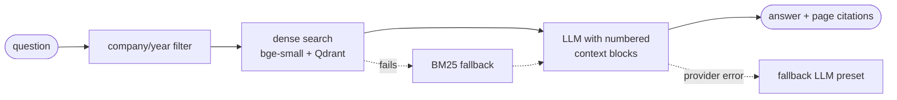

# FinSight RAG

**Grounded, cited question answering over SEC filings, built and measured end to end, running on a laptop at $0.**
Ask "What was 3M's FY2018 capital expenditure?" and get `$1,577 million [1]`, where [1] links to the exact page of
the 10-K. If the filings don't say, it answers *"Not found in the provided filings."*

> **Demo GIF:** not recorded yet. Run `make serve` + `make ui` and open http://localhost:8501
> (the "Under the hood" panel shows each retrieval stage, the timings and the token usage).

## The problem

Analysts dig through 100–300-page 10-K/10-Q filings. A plain LLM makes up numbers, and a wrong financial number is
expensive. A trustworthy system has to **find the right page, answer only from it, cite it, and say when it doesn't know**.
And every design choice should be **measured**, not copied from a blog post.

## How it works



Offline: PDFs → pages (tables rebuilt as rows) → 384-token chunks with a contextual header → Qdrant + BM25.
Online: filter → retrieve → generate with a grounding prompt → check citations → abstain if unsupported.
Full diagrams, including the `/v1/query` sequence: [docs/architecture.md](docs/architecture.md).

## Results (FinanceBench, 150 questions, page-level ground truth)

| What | Result | Report |
|---|---|---|
| Parsing: evidence text found on its gold page | **189 / 189** · label–number adjacency 0.28 → **0.97** vs plain extraction | [data_card.md](docs/data_card.md) |
| Retrieval, dense only (baseline) | hit@10 **0.46** · doc_hit@10 0.89 | [retrieval_ablation](results/2026-11-24_retrieval_ablation/report.md) |
| Hybrid BM25 + dense, no filter | hit@10 **0.32**: *worse* than dense (boilerplate questions) | [retrieval_ablation](results/2026-11-24_retrieval_ablation/report.md) |
| + company/year metadata filter (recursive_384) | hit@10 **0.613** · MRR 0.353 · doc_hit 0.993 · ~110 ms | [retrieval_ablation_extra](results/2026-11-24_retrieval_ablation_extra/report.md) |
| + local cross-encoder rerank (hybrid) | hit@10 0.580 at ~2.7 s, **not adopted** | [retrieval_ablation_extra](results/2026-11-24_retrieval_ablation_extra/report.md) |
| + contextual chunk headers | hit@10 **0.673** · recall@10 0.629 | [contextual_headers](results/2026-11-24_contextual_headers/report.md) |
| End to end, local Qwen2.5-1.5B (30 Q) | numeric match naive 0.24 → **filtered 0.31** · corrective 0.28 · $0 | [end_to_end](results/2026-11-24_end_to_end/report.md) |
| Serving, local process | p50 **2.5 s** (1 user) · 14.4 s (5 users, same throughput) · cache hit 0.01 s · 0 errors | [load_test](results/2026-11-25_load_test/report.md) |

With 150 questions the standard error is about ±0.04, so differences under ~0.05 are noise. Methodology and every
table: [docs/evaluation.md](docs/evaluation.md). **Honest caveats:** the local LLM judge rated 90/90 answers "correct",
so it isn't used as a metric (human-label validation pending). The answer-quality numbers use a small 1.5B model;
stronger models are one env var away but weren't run (no paid usage).

## Quickstart (macOS, Apple Silicon; needs [uv](https://docs.astral.sh/uv/))

```bash
cd finsight-rag && make setup       # Python 3.12 + dependencies (uv)
make data ingest index              # FinanceBench (~166 MB) -> pages -> chunks -> Qdrant + BM25 (~7 min first time)
make serve                          # terminal 1: backend API  -> http://127.0.0.1:8000/docs
make ui                             # terminal 2: frontend UI  -> http://localhost:8501
uv run python scripts/11_smoke_api.py   # terminal 3: health, ready, 3 questions, streaming -> PASS
```

No API keys and no Docker needed. The first question downloads the local LLM once (~3 GB).
Optional: `ollama serve` with `LLM=ollama-qwen7b` (better answers on the Mac GPU), or a free-tier key in `.env`
(`LLM=gemini-flash`, ...). Paid providers are refused unless you opt in. Operations, troubleshooting and switching
providers: [docs/runbook.md](docs/runbook.md).

### Learn it step by step

Each phase has a cell-based script (`scripts/NN_*.py`). You can run it in the terminal, cell by cell in VS Code, or as
a notebook (`make notebooks`):

```bash
make data                                   # step 01: download FinanceBench (~166 MB, ~25 s)
uv run python scripts/02_explore_data.py   # step 02: explore questions, evidence and consistency checks
uv run python scripts/03_parse_pdfs.py     # step 03: parse PDFs into clean pages + evidence check (~70 s)
uv run python scripts/04_chunk.py          # step 04: chunk pages (4 strategies), quality stats; --sweep compares all
uv run python scripts/05_embed_and_index.py  # step 05: embed chunks (~5 min first time), build Qdrant + BM25, sanity queries
uv run python scripts/05b_compare_embedders.py   # step 05b: compare embedders (local vs online) on the same chunks
uv run python scripts/06_retrieve.py            # step 06: one question through BM25 / dense / hybrid / rerank
uv run python scripts/07_eval_retrieval.py      # step 07: the retrieval ablation (~30 min with rerank variants)
uv run python scripts/08_generate.py --show-prompt   # step 08: a cited answer, the exact prompt, timings
uv run finsight query "What was 3M's FY2018 capex?"  # the same from the CLI (finsight llms: which LLM)
uv run python scripts/09_advanced_rag.py --technique multi_query   # step 09: query rewriting / corrective / agentic
uv run python scripts/10_eval_end_to_end.py --limit 30            # step 10: end-to-end answer quality
make serve   # API on :8000      then, in another terminal:
make ui      # demo UI on :8501  ·  uv run python scripts/11_smoke_api.py  (step 11)
```


### Choosing the embedding model (local or online)

```bash
uv run finsight embedders                    # presets, key status, free/paid, requests/time/quota estimates
echo "GEMINI_API_KEY=..." >> .env            # any free key you have (see .env.example for the links)
uv run finsight index --embedder gemini-001 --limit-questions 30   # its own collection; nothing overwritten
make compare-embedders E=bge-small,gemini-001 Q=30   # compare on 30 questions' filings (free-tier friendly)
```

### Run any step three ways

| How | Command |
|---|---|
| Terminal, all at once | `uv run python scripts/01_download_data.py --limit-docs 3` |
| VS Code, cell by cell | open a script, click **Run Cell** above each `# %%`; variables stay in the Interactive Window |
| Jupyter | `make notebooks && make jupyter`, then open `notebooks/01_download_data.ipynb` |
| VS Code notebook | `make kernel` once, open a `.ipynb`, **Select Kernel** → Jupyter Kernel → **Python 3.12 (finsight-rag)** |

Each cell runs one internal step and shows the result as a pandas DataFrame.

Further steps are added phase by phase. `make ingest` parses and chunks on all cores; `make index` embeds and builds both indexes (skipped when up to date). Dataset details: [`docs/data_card.md`](docs/data_card.md).


## Design decisions

| ADR | Decision | Because (measured) |
|---|---|---|
| [0001](docs/adr/0001-vector-store.md) | Qdrant embedded (dev) / server (optional), separate BM25 | No infrastructure; one config switch to a server |
| [0002](docs/adr/0002-chunking.md) | Recursive 384-token chunks + contextual headers | Best hit@10; headers +6 pts |
| [0003](docs/adr/0003-retrieval.md) | Dense + company/year filter; hybrid/rerank by config | Filter 0.46 → 0.61; hybrid + rerank 0.58 at 25× the latency |
| [0004](docs/adr/0004-llm-providers.md) | LLM presets, `auto`, free tiers only, fallback chain | $0 by default, runs offline, survives outages |

## Project layout

```
configs/          base.yaml + profiles (local, cloud, multihop) + model presets (llms, embedders) + experiments/
src/finsight/     data · ingestion · chunking · embedding · indexing · retrieval · generation · pipelines ·
                  evaluation · api · cache · observability · container (wires it all) · cli
scripts/          cell-based learning steps 00_check_env … 12_load_test (+ notebooks/ generated from them)
ui/               Streamlit demo UI (a thin client of the API)
tests/            unit + integration (fake models, offline, ~8 s) + slow; CI regression gate on retrieval
results/          committed evaluation reports (each with its config + fingerprint)
docs/             architecture · evaluation · runbook · adr/ · development guide · interview guide · data card · spec
```

## Configuration in one paragraph

`configs/base.yaml` holds every default. A profile (`configs/local.yaml` by default, or `configs/cloud.yaml`)
is deep-merged on top, then environment variables (`LLM_PROVIDER=anthropic`, or any
`FINSIGHT__SECTION__KEY=value`), then overrides passed in code. API keys come only from the environment
or `.env`. `uv run finsight show-config` prints the resolved config and its **fingerprint**, a hash
stored with every index and eval result so each number traces back to its exact settings.

## Limitations

- **Answer quality is capped by the local 1.5B model.** It finds the gold page 47% of the time but gets the number 31%.
  Claude/7B comparisons are wired up but not run.
- **No validated LLM judge.** The same-model local judge was useless. Validation with 20 human labels (`scripts/10b_label_judge_sample.py`) is pending.
- **One request at a time per process** on the local model (GPU lock). Throughput is ~17 answers/min.
- Embedded Qdrant allows one process at a time (close notebook kernels, or use a copy: runbook §1).
- FinanceBench's open sample is 150 questions: ±0.04 standard error. MultiHop-RAG support exists but hasn't been evaluated yet.

## Next steps

Run a stronger generator (Ollama 7B or a free-tier API) through `make eval` · validate a cross-family judge on human labels
· finish the query-transform (`make eval-advanced`) and MultiHop-RAG (`make multihop`) runs · an LLM-written contextual
header (vs the metadata header) · a batching inference server for concurrency · record the demo GIF.

## More docs

| Doc | For |
|---|---|
| [CODEMAP.md](docs/CODEMAP.md) | Where every module lives + recipes for common changes (read this before changing code) |
| [architecture.md](docs/architecture.md) | Components, data flow, the `/v1/query` sequence |
| [evaluation.md](docs/evaluation.md) | Methodology and every results table |
| [runbook.md](docs/runbook.md) | Run, rebuild, switch providers, debug a bad answer |
| [DEVELOPMENT_GUIDE.md](docs/DEVELOPMENT_GUIDE.md) | How it was built, phase by phase, with the decision log |
| [INTERVIEW_GUIDE.md](docs/INTERVIEW_GUIDE.md) | Concepts, likely interview questions, my numbers |
| [data_card.md](docs/data_card.md) · [PROJECT_SPEC.html](docs/PROJECT_SPEC.html) | Dataset details · the original spec |

## License notes

FinanceBench is CC-BY-NC-4.0 (non-commercial). The PDFs are downloaded by script and never committed.
PyMuPDF is AGPL-licensed.
