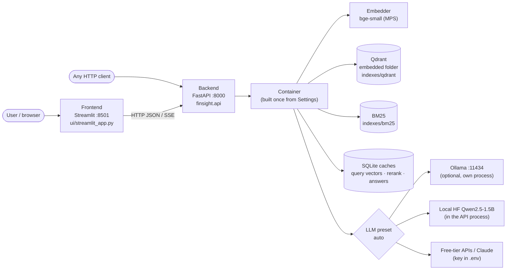
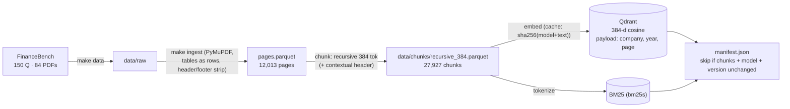
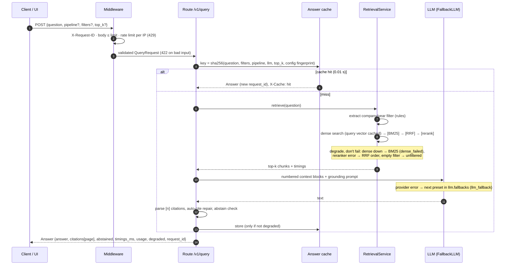

# FinSight RAG: architecture

How the pieces fit together, from PDFs to a cited answer. The diagrams are Mermaid, so GitHub renders them.

## 1. Runtime: three independent processes

- No Docker is needed: `ollama serve` (optional) + `make serve` + `make ui` ([runbook](runbook.md) §1).
- The **UI loads no models**. It calls the API, so the demo shows exactly what an API client gets.
- The **Container** (`src/finsight/container.py`) builds every component lazily from one `Settings`. The CLI, scripts,
  evaluation and API all use it, so the pipeline you evaluate is the pipeline you serve.

## 2. Offline: building the indexes

Re-running is free: the manifest skips unchanged indexes, and the embedding cache means only *new* chunk texts are
embedded (indexing into a fresh Qdrant server: 27,927/27,927 cache hits, 8 s).

## 3. Online: one `/v1/query` request

`/v1/query/stream` does the same, but emits Server-Sent Events: `retrieved` (the sources), then `token` deltas, then
`done` (citations and timings). The first token arrives after ~1.5 s with the local model.

## 4. Configuration

`configs/base.yaml` ← profile (`local.yaml` / `cloud.yaml` / `multihop.yaml`) ← env (`FINSIGHT__SECTION__KEY`, plus
aliases `LLM`, `EMBEDDER`, `QDRANT_URL`) ← CLI overrides. Models are **presets** (`configs/llms.yaml`,
`configs/embedders.yaml`). Paid-only providers are refused unless `allow_paid: true`, and free-tier rate limits are
enforced on the client side. The **config fingerprint** (a hash of the settings that change answers) is stored with
every result and keys the answer cache.

## 5. Where the code lives

| Concern | Module |
|---|---|
| Data, parsing | `finsight.data` (`financebench`, `multihop`, `datasets` dispatch), `finsight.ingestion` |
| Chunking | `finsight.chunking` (fixed, recursive, page_aware, parent_child; exact bge token counts) |
| Embeddings, indexes | `finsight.embedding` (local + online, SQLite cache), `finsight.indexing` (Qdrant, BM25, manifest) |
| Retrieval | `finsight.retrieval` (dense, sparse, RRF, filters, rerankers + score cache, query transforms, service) |
| Generation | `finsight.generation` (prompts, context blocks, citations, LLM providers, `FallbackLLM`) |
| Pipelines | `finsight.pipelines` (naive, hybrid_rerank, corrective, agentic) |
| Evaluation | `finsight.evaluation` (retrieval metrics + runner, end-to-end, judge, reports) |
| Serving | `finsight.api` (routes, middleware, models), `finsight.cache` (answers), `ui/streamlit_app.py` |

Design decisions with evidence: [ADRs](adr/). Measurements: [evaluation.md](evaluation.md).
